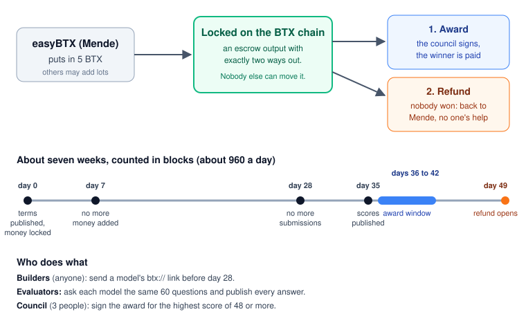

# BTX creation bounty 1: "BTX Explainer"

## In plain words

- **Who puts the money in:** easyBTX (Mende), 5 BTX from its bounty wallet.
  Anyone else may add a lot from their own node wallet; each lot goes back
  to whoever put it in if it is not awarded.
- **Where it is locked:** in an escrow output on the BTX chain. It has
  exactly two ways out, written into the coin itself: the **award** (a
  council signature, only between day 36 and day 42) or the **refund** (only
  to whoever put it in, only after day 49). Nobody can move it any other way:
  not Mende, not the council.
- **Who may submit:** anyone. A submission is a model's `btx://` link (one
  GGUF file of at most 4 GB, Apache-2.0 or MIT) and a short note: the base
  model, the licence, how it was made. Before day 28.
- **How the winner is chosen:** evaluators ask every model the same 60
  questions about BTX and publish every answer. 20 questions are public now;
  40 stay secret until submissions close (their fingerprint is in the terms,
  so they cannot be changed). Passing is 48 of 60. The highest passing score
  wins; a tie goes to whoever committed first.
- **Who signs:** a council of three named people, each with their own key
  on their own computer. On BTX 0.34.15 any one of them can sign the award
  alone, because its wallet cannot pass a half-signed award from one member
  to the next. Jpp-matata measured on 0.35.0rc1 that two of three can sign
  in turn with the general PSBT tools; once that is repeated here, the terms
  can ask for two of three.
- **If nobody wins:** nothing is paid. From day 49 the money goes back to
  whoever put it in, with nobody's help or permission.
- **Costs:** the 5 BTX, plus about 0.002 BTX of network fee per transaction
  (locking it, then the award or the refund). 5.01 BTX covers both.
- **Times:** counted in blocks, about 960 a day, from the day the terms are
  published: money in until day 7, submissions until day 28, scores by day
  35, the award between day 36 and day 42, the refund from day 49.

Status, 2026-10-14: the terms are written and rehearsed; the council needs
two more keys before the terms are published and the money is locked.

## Details

The first creation bounty on BTX's model plane, requested by easyBTX
(Mende): **5 BTX** for an open-weight language model (one GGUF of at most
4 GB, Apache-2.0 or MIT) that answers questions about BTX and its model
network correctly from two public sources, the btx repository at tag
v0.34.15 and the BTX Handbook (easybtx.com/handbook).

| File | What |
|---|---|
| `evaluation-spec.md` | the deliverable, the sources, the test, the score, the harness |
| `questions-public.json` | 20 of the 60 questions, with their required facts; the other 40 are held out until submissions close, their SHA-384 is in the terms |
| `grade.py` | the grader: asks a llama.cpp server every question at temperature 0 and checks the facts |
| `make-terms.py` | writes the BountyTerms from the current tip, the council keys and the spec's hash |
| `council-howto.md` | what a council member does: one post-quantum key now, one signature after the award height |

Status, 2026-10-13: the lifecycle (publish, fund into the two-leaf escrow,
award, refund) is rehearsed on regtest with the 0.34.15 release binaries.
The council is being formed; the terms are published when it is. Anyone
may fund a further lot from their own node wallet with their own refund
key (`preparebountyfunding`); an unawarded lot refunds to its contributor
after the refund height.

Baseline: a stock Granite 4.2 3B answers 0 of 60.
